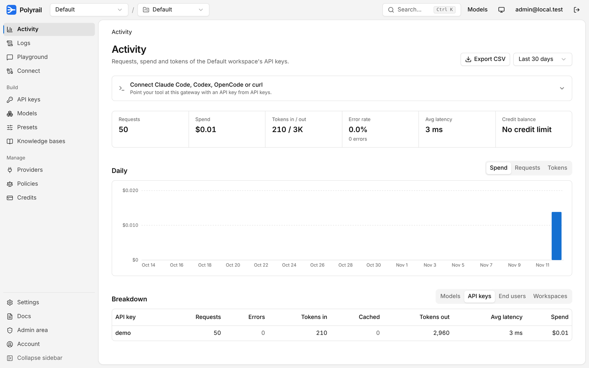
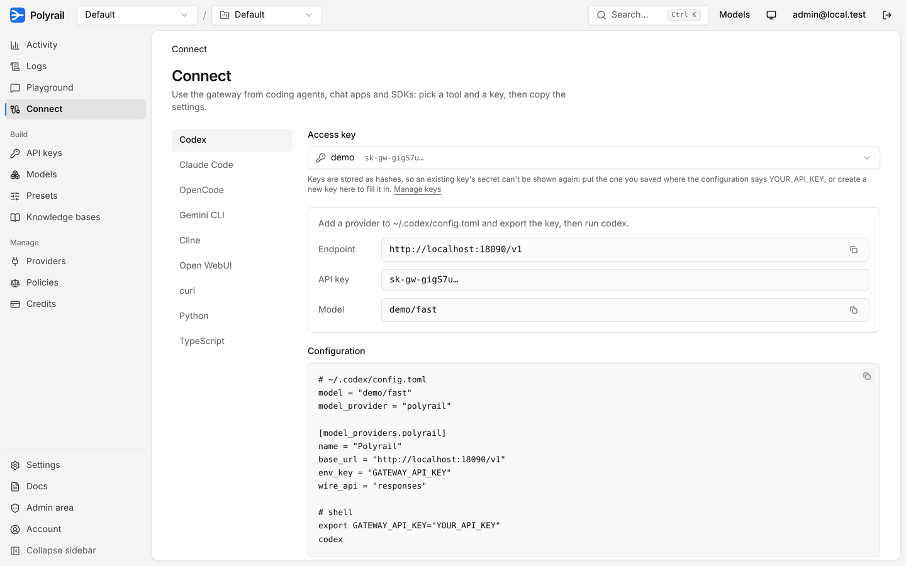
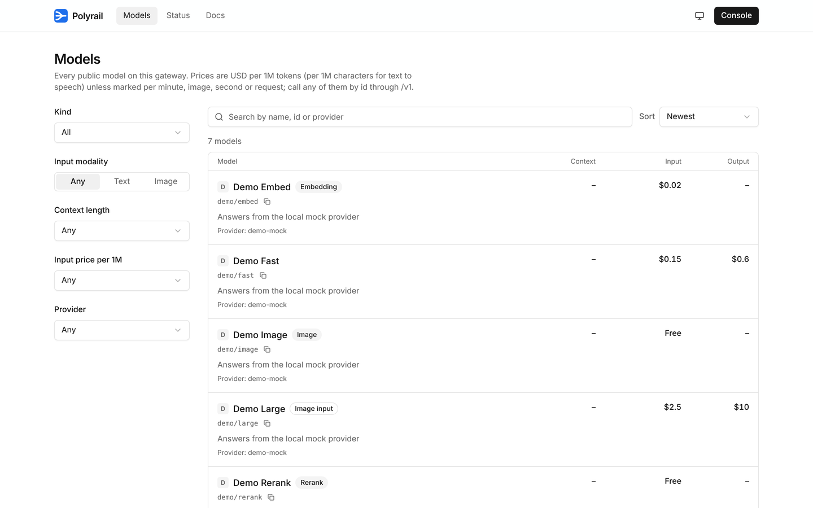
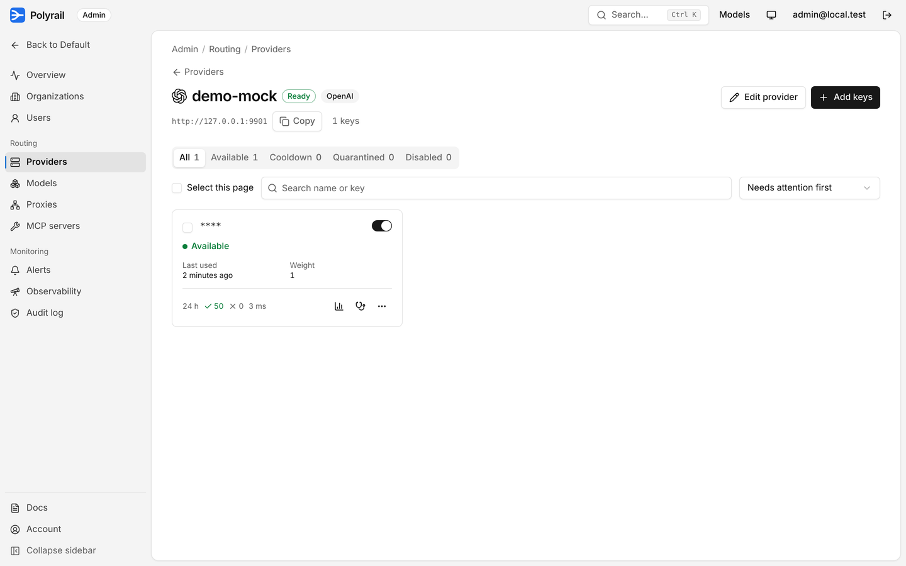
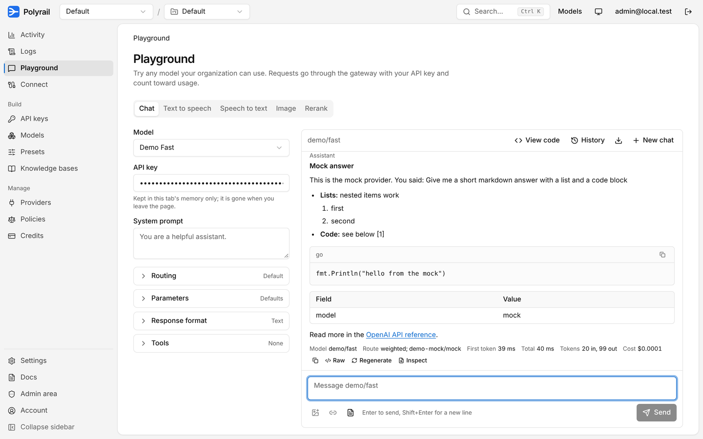

<p align="center"></p>

<h1 align="center">Polyrail</h1>

<p align="center"><b>One API for every model. Self-hosted, light, open.</b></p>

<p align="center">
An open-source AI gateway you run yourself: one OpenAI-compatible endpoint in front of 36 provider
types, with keys, budgets, routing, guardrails and analytics built in.<br>
Think OpenRouter, on your own server, in one Go binary.
</p>

<p align="center">
<a href="#start-in-one-minute">Quick start</a> ·
<a href="#what-you-get">Features</a> ·
<a href="#connect-your-tools">Connect your tools</a> ·
<a href="docs/DEPLOY.md">Deploy</a> ·
<a href="docs/API.md">API</a>
</p>



## Why Polyrail

Teams that use AI end up with a key for OpenAI, another for Anthropic, a Gemini project, a local
Ollama box, and nobody knows who spent what. Polyrail puts all of them behind one endpoint and one
console:

- **Your apps and coding agents talk to one URL.** Claude Code, Codex, OpenCode, Gemini CLI, Cline,
  Open WebUI and any OpenAI SDK work by changing the base URL and key.
- **You decide who uses which model, and how much.** Per-key and per-member budgets, rate limits,
  model allowlists, guardrails and an audit log of every change.
- **Requests keep working when a provider fails.** Weighted routing, automatic failover across
  providers and models, circuit breakers, and a pool of provider keys with health checks.
- **Your data stays on your server.** Self-hosted, Apache-2.0, no telemetry. Prompts are not stored
  unless an org turns content logging on.
- **It is small.** One binary with an embedded database. Measured idle: about 60 MB of memory and
  under 1% of one CPU core. It scales out to stateless replicas on Postgres + Valkey + ClickHouse when
  you need it.

All provider calls go through [Bifrost core](https://github.com/maximhq/bifrost), so Polyrail adds
features on top of a maintained provider engine instead of hand-written adapters.

## Start in one minute

**Docker**

```sh
docker run -p 8080:8080 -v polyrail:/data \
  -e MASTER_KEY=$(openssl rand -hex 32) \
  -e ADMIN_EMAIL=you@example.com -e ADMIN_PASSWORD='choose-a-long-one' \
  ghcr.io/thuongh2/polyrail:edge
```

**From source or a release binary**

```sh
./scripts/run-local.sh            # starts Polyrail and prints the sign-in details
DEMO=1 ./scripts/run-local.sh     # also starts a mock provider with demo models, a key and traffic
```

Then open `http://localhost:8080/app/`, sign in, go to **Admin → Providers**, paste an API key into
a provider (OpenAI, Anthropic, Gemini, …) and it switches on. Its models from the built-in catalog
(265 models, generated from [models.dev](https://models.dev)) become available right away.

```sh
curl http://localhost:8080/v1/chat/completions \
  -H "Authorization: Bearer sk-gw-..." -H "Content-Type: application/json" \
  -d '{"model": "openai/gpt-4o-mini", "messages": [{"role": "user", "content": "Hello"}]}'
```

## Connect your tools

The **Connect** page gives you the exact settings for each tool: pick the tool and an API key, copy
the endpoint, key and config.



| Tool | Endpoint |
|---|---|
| OpenAI SDKs, Codex, OpenCode, Cline, Open WebUI, curl | `https://your-host/v1` |
| Claude Code and Anthropic SDKs | `https://your-host/anthropic` |
| Gemini CLI and Google GenAI SDKs | `https://your-host/genai` |

## What you get

### One API for every kind of model

- Chat completions (streaming and not), Responses API, legacy completions, embeddings, images
  (generate, edit, variations), text to speech, speech to text, rerank, OCR, video jobs, files and
  batches, vector stores.
- OpenAI, Anthropic Messages and Google GenAI request formats on the same models.
- Provider types from Bifrost core: OpenAI, Azure OpenAI, Anthropic, AWS Bedrock and SageMaker,
  Google Vertex AI and Gemini, Mistral, Groq, Cohere, DeepSeek, xAI, Fireworks, Ollama, vLLM, SGLang, Cerebras, Perplexity, OpenRouter, Hugging Face,
  Replicate, Databricks, Cloudflare, ElevenLabs, Runway and more. Any OpenAI-compatible URL works too.
- A public model catalog with prices, context length, modalities and live provider health.



### Routing that survives outages

- Several targets per model with strategies: weighted, priority, round-robin, random, power of two
  choices, least-used, lowest latency, lowest cost and cache affinity.
- Automatic failover to the next target, then to fallback models; circuit breakers skip failing
  targets.
- OpenRouter-style request routing: `models: [...]`, `provider.order / only / ignore / sort`,
  `max_price`, `:nitro` and `:floor`, plus saved presets (`@preset/name`).

### Provider key pools

Add many keys to one provider. Each key is tested, gets its own request and error chart, cools down
on rate limits and is quarantined after repeated authentication failures, with alerts when it happens.



### Spend control

- Per-model prices per 1M tokens, including prompt-cache read and write prices; cost per request in
  the response (`usage.cost`) and an `X-GW-Cost-Micros` header.
- Prepaid org credits, per-key monthly budgets, and policy budgets per org, workspace, member or
  key (daily, weekly, monthly or lifetime).
- Exact response cache and semantic cache, idempotency keys, and prompt compression.

### Guardrails and policies

- PII masking, credential masking, prompt-injection detection, regex filters that redact or block.
- Policies with allowed models and providers, zero-data-retention and no-training requirements, and
  data-region rules (global, Europe, US), refused with a clear 403 reason.

### Teams and enterprise identity

- Organizations, workspaces, roles (owner, admin, member, viewer) and platform operators.
- SSO with OIDC and SAML, verified domains, enforced SSO, SCIM provisioning.
- API keys stored only as hashes, key rotation with a grace period, management tokens for automation,
  and an audit log of every admin action.

### See everything

- Activity by model, key, member, end user and workspace, from the last hour to 90 days; CSV export.
- Request logs, optional encrypted content logging with a retention limit.
- Prometheus metrics, JSON logs, OpenTelemetry trace export (Tempo, Jaeger, Datadog, Langfuse, …).
- Webhooks (signed) and alerts to Telegram, Slack, Discord, Teams, Google Chat, ntfy, Pushover,
  Gotify, Matrix and Mattermost.

### Built-in RAG and tools

- Knowledge bases: upload documents, and the gateway adds the relevant passages to requests that ask
  for them, with sources in the response.
- MCP servers: register them once, grant them per org, and their tools run through the gateway.
- Upstream proxies and rotating proxy pools for provider traffic.

### A console people enjoy using

A playground with Markdown, code, tables, images, JSON mode, tools and a request inspector; a
command palette (Ctrl+K); light and dark themes; works on phones.



## Light by design

Measured on the development machine with a local mock provider, so the numbers show gateway
overhead rather than model latency:

| | Result |
|---|---|
| Idle, full catalog loaded | about 61 MB memory, about 0.3% of one CPU core |
| 5,000 chat requests at concurrency 50, `GOMAXPROCS=1` | about 7,700 requests per second, p50 5.3 ms, p99 18 ms, 0 errors, peak 69 MB |

The load generator shared the same CPU. Your numbers will differ; [docs/PROGRESS.md](docs/PROGRESS.md)
has the method.

| Size | Setup |
|---|---|
| Small team, one VPS (1 vCPU / 2 GB) | one binary, embedded Pebble database |
| Many users, several nodes | stateless replicas on Postgres (config), Valkey (limits), ClickHouse (analytics) |

## Documentation

- [docs/CONFIG.md](docs/CONFIG.md): every environment variable
- [docs/DEPLOY.md](docs/DEPLOY.md): VPS, Docker, scale-out, backups, CI/CD, hardening
- [docs/API.md](docs/API.md): gateway and admin endpoints
- [docs/ARCHITECTURE.md](docs/ARCHITECTURE.md): design and storage tiers
- [docs/SECURITY.md](docs/SECURITY.md): threat model and review findings
- [docs/KEYS.md](docs/KEYS.md), [docs/KB.md](docs/KB.md): provider key pools, knowledge bases
- [docs/OPENROUTER_ENTERPRISE.md](docs/OPENROUTER_ENTERPRISE.md): feature parity with OpenRouter Enterprise

## Contributing

```sh
make check   # go vet + race-enabled tests
TEST_POSTGRES_URL=postgres://... TEST_REDIS_URL=redis://... make check   # also the scale-mode backends
make ui      # rebuild the embedded console after changes in web/
```

Polyrail is built by an AI agent team (product owner, tech lead, developer, QA, security and an
anti-slop reviewer) working under written rules: test first, verify before claiming, security review
on every feature. Their rules and memory are in [CLAUDE.md](CLAUDE.md) and `.claude/agents/`.

Coming from agent-gateway (the former name)? Data, env vars, API paths, `X-GW-*` headers and `sk-gw-`
keys are unchanged; see [docs/DEPLOY.md](docs/DEPLOY.md#upgrading-from-agent-gateway).

## License

Apache-2.0, the same as Bifrost core.
